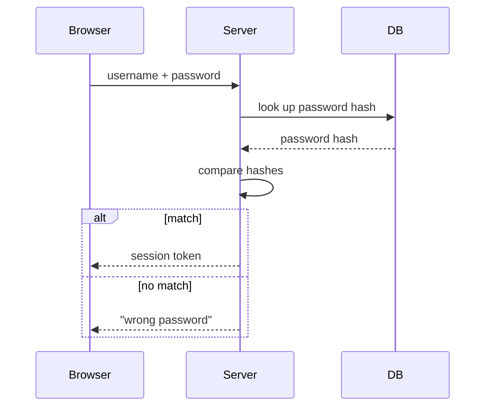

# Rung 2: diagram

## When

The core of the content is **structure**: what connects to what, order, cause and effect, hierarchy, transitions between states. Text can only describe structure one sentence at a time; the reader has to assemble it in their head. A diagram lays it out at once.

## Step 1: choose the type

| Content | Type | Mermaid |
|---|---|---|
| Steps and branches | Flowchart | `flowchart LR` / `flowchart TD` |
| Several parties exchanging messages | Sequence diagram | `sequenceDiagram` |
| Transitions between states | State diagram | `stateDiagram-v2` |
| Parent/child, containment | Hierarchy | `flowchart TD`, or `mindmap` |
| A causes B, B affects C | Causal graph | `flowchart LR`, label edges "increases" / "decreases" |
| Two or three things compared item by item | Table | Markdown table (a table is a diagram too) |

One diagram answers one question. Two questions, two diagrams. Use the fewest diagrams possible: a diagram that does not teach the core intuition is not drawn.

## Step 2: write the rung-1 draft first

Write the plain-text draft (rung-1 rules). Every node and edge must appear in the draft. The diagram adds no new facts.

## Step 3: draw

1. ≤8 words (≤8 Chinese characters) per box. Nouns in boxes, verbs on edges.
2. **Every arrow has a text label.** An unlabeled arrow claims "there is a relation" without saying which; a missing arrow claims "no relation". Both are assertions — when unsure, draw the arrow with a conservative label.
3. ≤12 nodes. More than that: split into two diagrams, or collapse detail into a sub-process box.
4. Same kind of thing, same shape. E.g. data = rounded box, step = rectangle, decision = diamond.
5. One direction: left→right or top→bottom.
6. Terms match the draft exactly. If the draft says "token", the diagram does not say "credential".

Where to output:

- In a coding-agent session (writing files is normal), default to a **single-file SVG or inline-SVG HTML** in the working directory: self-contained, offline, diffable, pixel-precise.
- Use a Mermaid code block when chat-inline rendering matters (most chat UIs and GitHub render it) or the user asks for Mermaid.
- In Mermaid, quote labels that contain parentheses, quotes, or colons: `A["input (x)"]`. For non-ASCII state names in `stateDiagram-v2`, declare them: `state "已支付" as paid`.

Tool rules:

- Hand-write the SVG source directly. Do not invoke external typesetters (LaTeX, dvisvgm) or rasterizers — the reader's browser is the only renderer. A machine without LaTeX must be able to produce every figure.
- Math in figures: Unicode in plain `<text>` elements (Δ, σ, ≥, →), never rendered TeX.
- Visual self-check: agents cannot read SVG as an image directly. If no rasterizer (rsvg-convert, ImageMagick) exists, verify by re-reading the SVG source or by opening the file in a browser. Do not install tools just to preview.

## Step 4: caption and how to read it

Directly under the diagram:

1. A one-line caption: `Figure N: one sentence.` / 「图 N：一句话说明。」
2. 2–4 sentences on **how to read it**:

> Read left to right. Rectangles are steps, diamonds are decisions. Red edges are the error path.

## Step 5: arrow-by-arrow readback

After drawing, read every arrow aloud as a full sentence ("A increases B", "the server writes to the DB"). For each one, check: is this claim true, and is it in the rung-1 draft? Then check every pair of nodes with **no** arrow between them: is the absence of a relation also intended?

## Example

Question: "What happens between the browser, the server, and the database when a user logs in?"

Figure 1: the message sequence of a login attempt, with the two possible outcomes.

How to read it: time runs top to bottom. Solid arrows are requests, dashed arrows are responses. The boxed part shows two outcomes; only one happens.
